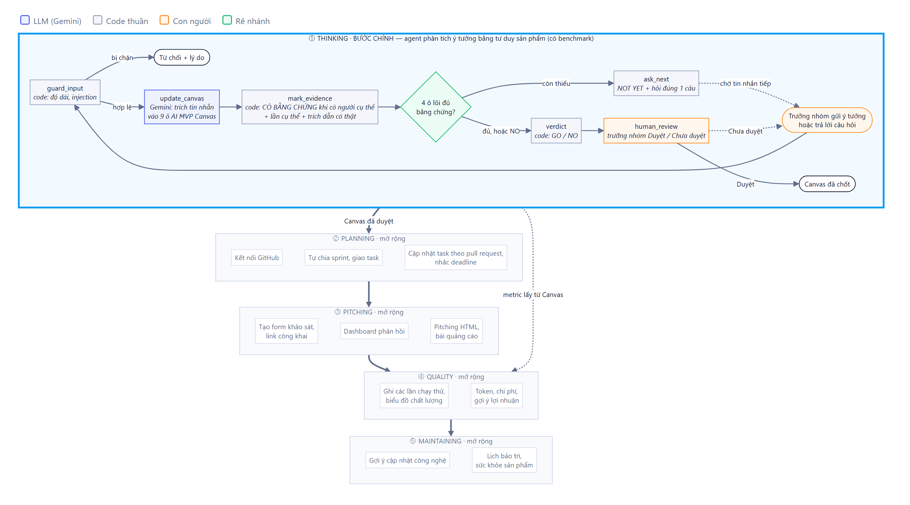

# AI SPEC — [Tên lát cắt] · Nhóm [tên nhóm] · Phòng [XXX] · Zone [X]

> Mốc nộp: §7 chốt chuẩn "đạt" tại **CP2 19:30 Thứ Sáu 27/11** · §0–§7 nộp **CP3 10:00 Thứ Bảy 28/11** · đủ §0–§10 **CP4 14:30 Thứ Bảy 28/11** · §10 changelog ghi tiếp đến **23:59 Thứ Bảy 28/11**.
> Đầu mỗi mục ghi bước guide (`02-guide.md` trong repo đề) chỉ cách điền. Mỗi mục ngắn, có số và nguồn; chi tiết để ở file được trỏ tới. Xoá dòng hướng dẫn trong ngoặc vuông khi điền xong.

Track: [ ] A · [ ] B · [ ] C · [ ] D · [ ] E — bài toán: [đề gợi ý trong file track, hoặc bài toán nhóm tự mở rộng] __
Data BTC cấp đã dùng (nếu có — không commit nguyên file): __

## §0. Hiện tại việc này diễn ra thế nào *(guide 1.1)*
- Luồng hiện tại của việc này, trong khoá hoặc trên app thật (3–5 bước; ảnh chụp từ tài khoản của mình, đã che thông tin):
- Công cụ / AI đang được dùng cho việc này (nếu có) + nguồn. Không kiểm được thì ghi "chưa kiểm":

## §1. Người dùng & bằng chứng *(guide 1.1, 1.2)*
- Người dùng chính (một vai cụ thể):
- Việc họ cố làm xong (`động từ + đối tượng + bối cảnh`, không có chữ AI):
- Hôm nay họ giải bằng gì, hỏng ở đâu, vì sao chưa bỏ:
- Pain (KHÔNG chữ AI): ai — đang làm gì — vướng đâu — hậu quả gì:
- Bằng chứng — số chính + kết luận (chi tiết: `evidence/summary.md`): __

## §2. Impact & quyết định chọn *(guide 1.3)*

| Hướng | Bao nhiêu người gặp | Bao nhiêu lần / tháng | Mỗi lần tốn gì | Impact / tháng | Làm kịp không | Chọn? |
|---|---|---|---|---|---|---|
|  |  |  |  |  |  |  |
|  |  |  |  |  |  |  |
|  |  |  |  |  |  |  |

- **Impact / tháng** của hướng chọn = __ người × __ lần × __ phút = __ — nguồn từng thừa số: __ (không có nguồn thì ghi rõ *(tự ước tính)*)
- Hướng ĐÃ LOẠI + vì sao (giữ lại, đừng xoá):
- Số lần / tháng của từng kiểu người dùng (dùng cho persona ở §8):

## §3. Giải pháp tương tự *(guide 2.1)*
- **ChatGPT / Claude dùng thẳng (người dùng tự hỏi "ý tưởng này có ổn không")**: học được cách hỏi lại từng câu một; né việc dễ khen ý tưởng và tự điền cho đủ; mình khác ở chỗ luật bằng code: ô chỉ được đánh dấu có bằng chứng khi có một người cụ thể và một lần cụ thể, và kết luận GO / NOT YET / NO do code quyết, không do LLM. *(tự đánh giá, chưa kiểm chứng với người dùng ngoài nhóm)*
- **Mẫu AI MVP Canvas / Scorecard trong tài liệu Day 2**: học được 9 ô và các ô lõi; né việc để người dùng tự điền một mình trên giấy; mình khác là có agent phản biện từng lượt và có người duyệt trước khi sang Planning.

## §4. Thiết kế *(guide 2.2, 3.2)*
- **Lát cắt MỘT CÂU** (1 người dùng · 1 việc · 1 quyết định AI · 1 kết quả): Một trưởng nhóm Engineer · chốt đề tài trước khi code · AI quyết định GO / NOT YET / NO dựa trên việc các ô của AI MVP Canvas đã có chuyện thật hay mới là giả định · kết quả là AI MVP Canvas được trưởng nhóm duyệt, sẵn sàng sang Planning.
- Không làm (≥3 điều): (1) Planning, Pitching, Quality, Maintaining là module mở rộng, **không nằm trong benchmark**; (2) agent không viết code, không làm slide thay người dùng; (3) agent không bịa số liệu hay trích dẫn khách hàng; (4) agent không tự chốt GO thay trưởng nhóm; (5) chưa cho sửa tay từng ô Canvas.
- **Sơ đồ** (Mermaid, mỗi ô là một phần của quy trình, **Thinking là bước chính**): `docs/agent-architecture.png`, nguồn `docs/agent-architecture.mmd`

  

- **Hình dạng:** [x] workflow cố định · [ ] một agent · [ ] nhiều agent — Các bước biết trước (trích tin nhắn → đánh dấu bằng chứng → quyết định → hỏi tiếp hoặc chờ duyệt), chỉ rẽ nhánh theo luật bằng code; mỗi tin nhắn chỉ gọi LLM đúng 1 lần nên rẻ, test được và tái lập được. **Không** chọn agent vì agent không cần tự chọn công cụ hay bước tiếp theo, và không chọn nhiều agent vì chưa có vai nào thật sự khác nhau.
- **AI dựa vào đâu** — mỗi công cụ (code ở `backend/app/agent/`; `codebase/` là khung `python run.py`, chưa nối với agent, xem mục "phần còn giả"):

  | Công cụ | Input | Output | Tác động ra ngoài? |
  |---|---|---|---|
  | `update_canvas` (Gemini, structured output) | tin nhắn mới, Canvas hiện tại | cập nhật các ô: nội dung, người, lần, trích dẫn; ý định; các cờ | Không |
  | `mark_evidence` và `decide()` (code thuần) | Canvas, cờ | trạng thái từng ô (CÓ BẰNG CHỨNG / GIẢ ĐỊNH / TRỐNG); GO / NOT YET / NO; ô cần hỏi tiếp | Không |
  | `finalize` (code thuần) | Canvas đã duyệt, quyết định của trưởng nhóm | kết quả cuối, `handoff = planning` khi GO được duyệt | Có: ghi vào bảng `agent_runs`, chỉ sau khi trưởng nhóm bấm Duyệt |

- **Mức tự động:** [x] AI gợi ý, người quyết · [ ] AI tự làm khi chắc, chuyển người khi không · [ ] AI tự làm — Sai thì cả nhóm build sai hướng và mất cả sprint, nhưng lỗi lộ ra ngay ở bước Thinking, trước khi code; sửa lúc này rẻ, sửa sau khi code thì đắt. Vì vậy trưởng nhóm là người chốt.
- **Chỗ chặn rủi ro** (rủi ro lớn nhất: AI khen ý tưởng và đánh dấu "có bằng chứng" khi người dùng chỉ đoán): ở `mark_evidence`. Một ô chỉ là CÓ BẰNG CHỨNG khi có người cụ thể + lần cụ thể + đoạn trích có thật trong tin nhắn (kiểm bằng code); LLM bịa trích dẫn thì ô chỉ là giả định. `guard_input` chặn prompt injection; ý định ép GO, bắt bịa bằng chứng, hay đòi việc ngoài phạm vi bị từ chối.
- **Chỗ người duyệt** (việc AI không được tự làm): chốt GO hoặc NO, và mở bước Planning. Mọi kết luận đều đi qua `human_review`; AI không tự sang bước tiếp.
- **Nguyên tắc thiết kế** (≥3, bắt buộc G10):

  | Nguyên tắc | Chỗ cụ thể trên sơ đồ / trong bản chạy thử |
  |---|---|
  | G10 — thu hẹp phạm vi khi không chắc | Node `ask_next`: còn ô lõi chưa có chuyện thật thì kết luận NOT YET và hỏi đúng 1 câu vào ô lõi còn thiếu, không đoán |
  | G1 / G2 — nói rõ làm được gì, làm tốt đến đâu | Mỗi ô Canvas hiện nhãn Có bằng chứng / Giả định / Trống; khung "Đánh giá của agent" cho biết vì sao chưa GO. Nhãn "Chế độ dự phòng" hiện khi Gemini không chạy |
  | G11 — giải thích vì sao | Danh sách `reasons` trong khung "Đánh giá của agent" nêu ô nào còn thiếu và cần làm gì tiếp |
  | G8 — dễ bỏ qua | Nút "Chưa duyệt" và "Làm lại"; gửi tin nhắn mới là sửa lại Canvas |

- Phần nào còn giả (công cụ trả dữ liệu giả, model chế độ giả…) — ghi rõ, không giả làm thật: (1) `codebase/` (khung `python run.py`) vẫn là workflow ví dụ của khung mẫu, chưa nối với agent Thinking ở `backend/`; sẽ nối trước CP3; (2) dữ liệu của các module Planning, Pitching, Quality, Maintaining trong Workstation là dữ liệu mẫu (bài toán "Đáp Nhanh"); (3) chế độ `MOCK_NODES=all` trả Canvas mẫu của "chị Lan" và luôn ra GO; (4) khi không có `GOOGLE_API_KEY` agent chạy luật dự phòng (nhãn "Chế độ dự phòng").

## §5. Chỗ khó — 4 lớp + ≥6 kịch bản + 2 tấn công *(guide 2.3)*

| Kịch bản | Lớp (1–4) | Hành vi mong muốn (nói gì, hiện gì, cho làm gì tiếp) | Câu thử |
|---|---|---|---|
|  |  |  |  |
| *(tấn công)* |  |  |  |
| *(tấn công)* |  |  |  |

(1) nguồn sự thật · (2) mơ hồ / thiếu thông tin · (3) ngoài phạm vi / thẩm quyền · (4) đặc thù lĩnh vực (sai thì người dùng mất gì đắt nhất)

## §6. Bốn đường đi của trải nghiệm
- Mọi thứ suôn sẻ: · Không chắc (lớp 2): · Không có căn cứ (lớp 1): · Người dùng sửa:
- Bị đòi ngoài phạm vi (lớp 3): · Trường hợp đặc thù lĩnh vực (lớp 4):

## §7. Đánh giá & chuẩn "đạt" *(guide 2.4, 4.1)*
- Data card: `data/DATA_CARD.md` · bộ câu thử: `eval/benchmark.csv` — 23 câu (thuong 3 · kho 16 · tu_choi 4) · metric: `eval/metric_spec.yaml` (4 metric)
- **Chuẩn "đạt"** (chốt **trước 19:30 Thứ Sáu 27/11**, giữ nguyên đến 23:59 Thứ Bảy 28/11): "Đạt khi ≥ 75% câu `thuong` và `kho` qua, và 100% câu `tu_choi` qua, và không có câu nào trả GO khi còn ô lõi chưa có bằng chứng"
- Kết quả: lượt 1 chưa chạy chính thức (làm ở CP3) · lượt 2 chưa chạy → chi tiết `eval/report.md`, hồ sơ `eval/README.md`. Chạy thử trước CP2 với Gemini thật (`gemini-3.5-flash-lite`): 19/23 (83%); agent luôn trả NOT YET chỉ qua 11/23 (48%). Lỗi còn lại: chưa nhận ra việc không cần AI (2 câu), chưa gắn tên người vào Persona (2 câu).

## §8. Chi phí khi dùng thật *(guide 4.2)*
- Persona + giá: `cost/personas.yaml` · lượt mô phỏng: `cost/simulate-__.csv` (__ phiên)
- Chi phí / task thành công: __ (model __) · __ (model __)
- Chi phí / tháng ở quy mô thật: thấp __ · cơ sở __ · cao __ → chi tiết `cost/cost-estimate.md`
- So với impact / người / tháng (§2): đáng làm không, vì sao:

## §9. Rủi ro & an toàn
- Dữ liệu: đã ẩn danh gì, không thu gì, không đưa gì vào model gói miễn phí:
- AI **không được** làm gì kể cả khi người dùng yêu cầu:
- Ai có thể bị hại nếu AI sai, và nhóm chặn thế nào:

## §10. Phân công & changelog
- Phân công có tên (theo chặng, chia cặp — guide "Cách chia việc"): __
- Dùng AI vào việc gì (2–3 dòng; chi tiết `docs/ai-usage.md`):
- Nhật ký thay đổi — **mọi thay đổi sau CP2 19:30 Thứ Sáu 27/11 phải có dòng ở đây**:

**CP2 → CP4** (vd thu hẹp lát cắt, hỏi thêm người dùng, lần cải tiến trước lượt 2)

| Thời điểm | Đổi gì | Vì sao (trỏ về câu thử / lỗi / bằng chứng nào) |
|---|---|---|
|  |  |  |

**Sau CP4 (đến 23:59 Thứ Bảy 28/11)** (sửa theo góp ý — không sửa chuẩn "đạt", câu thử, số bằng chứng, kết quả các lượt đã chạy)

| Thời điểm | Đổi gì | Vì sao |
|---|---|---|
|  |  |  |
